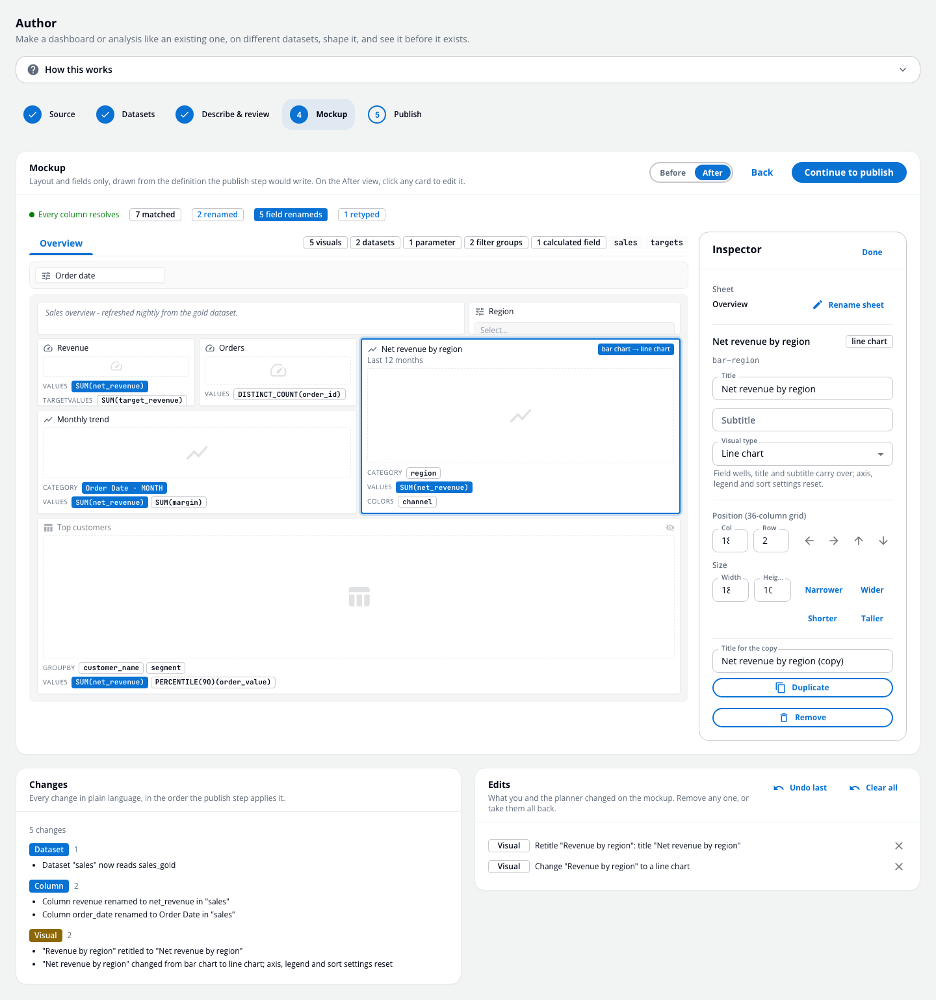
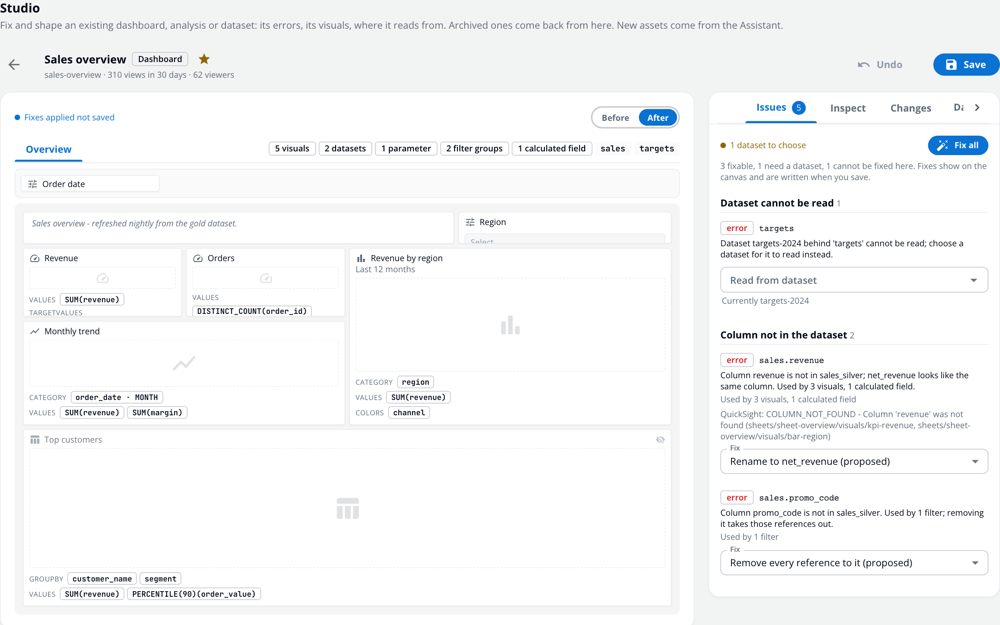
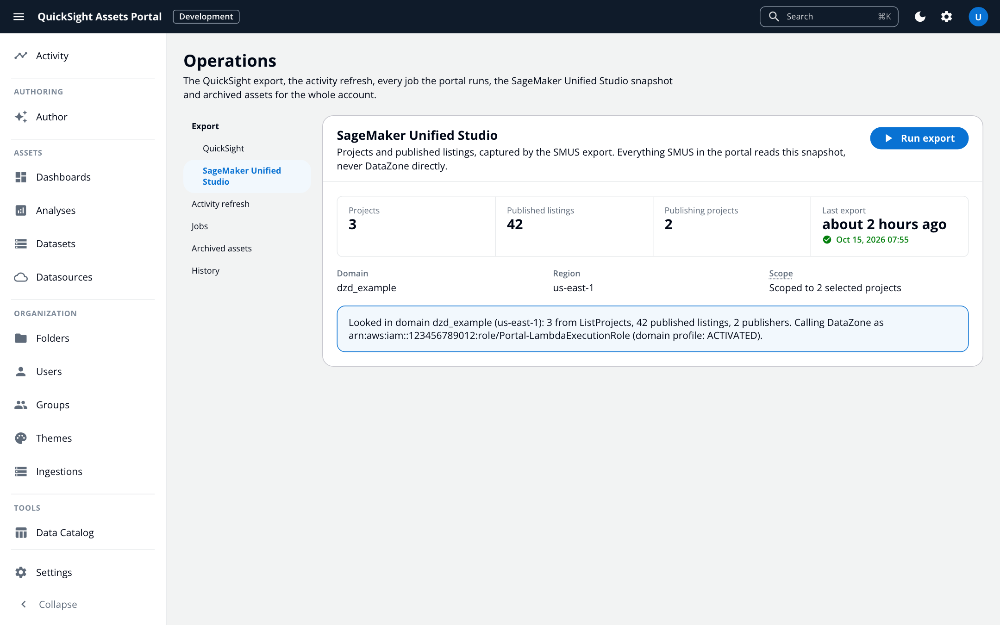
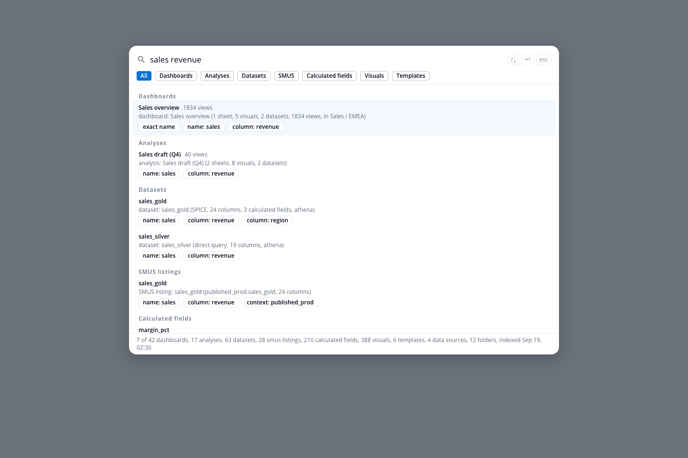
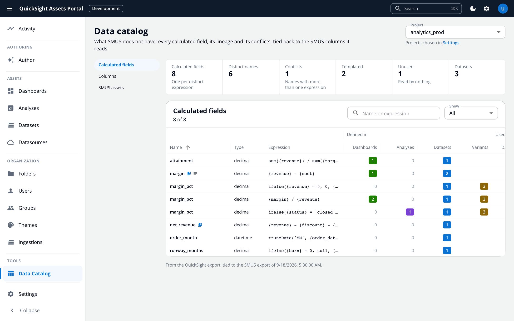
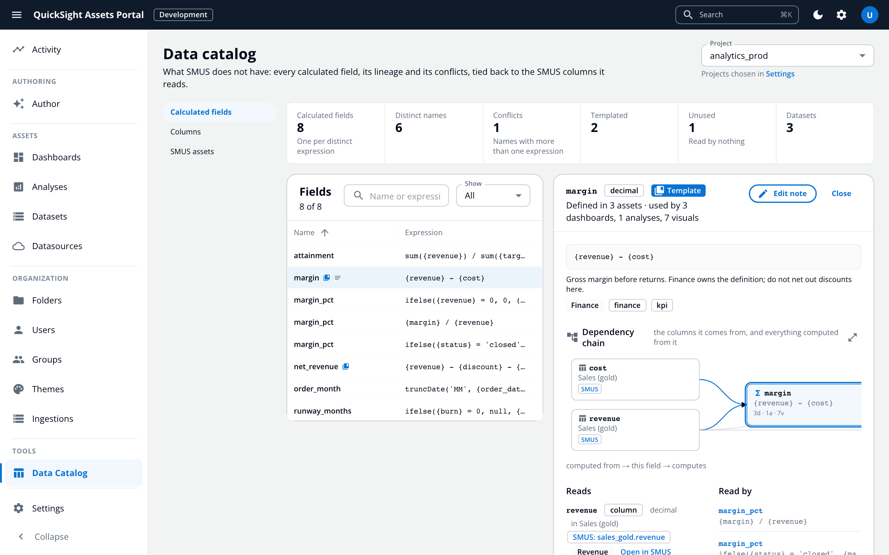
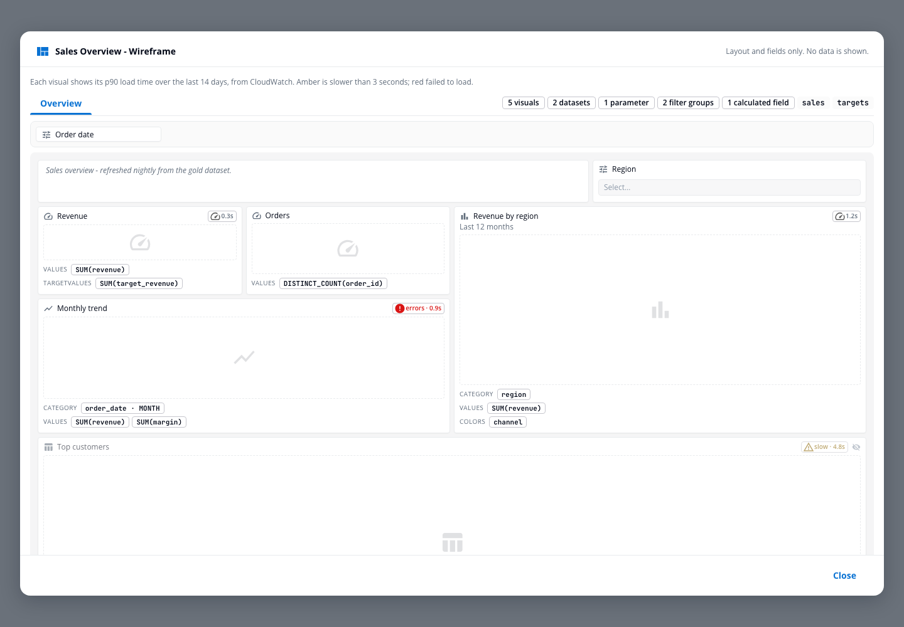
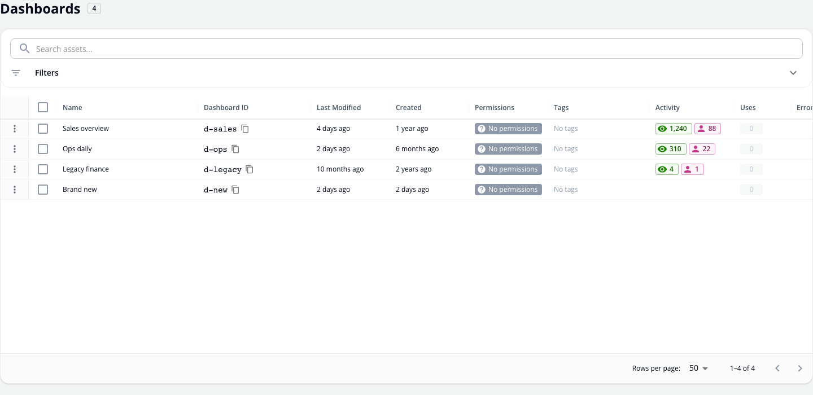
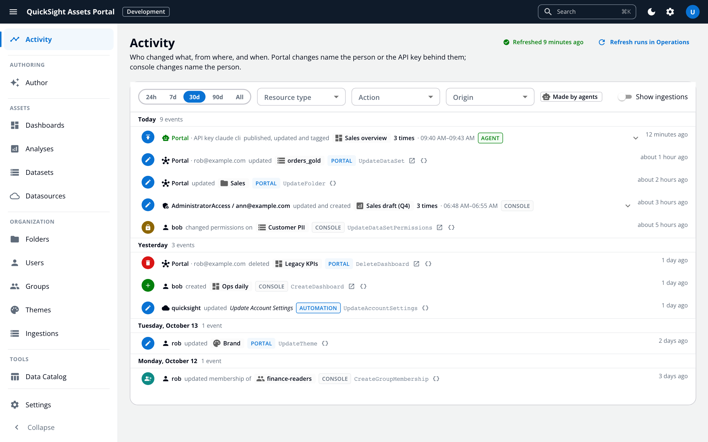
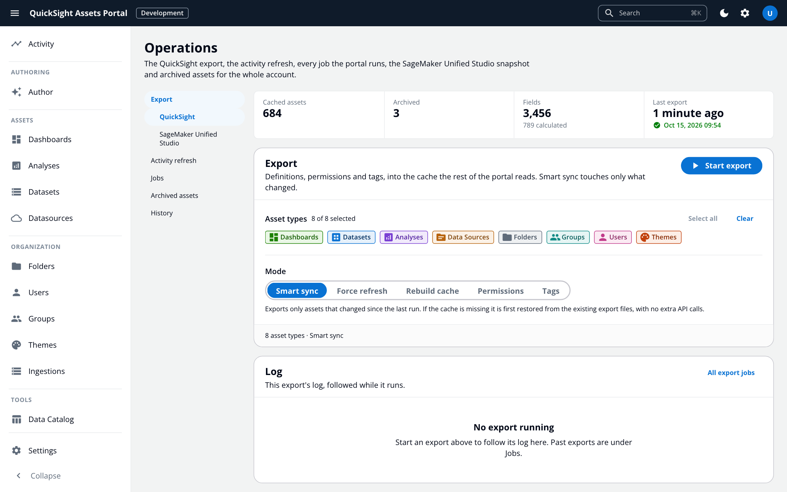

# QuickSight Assets Portal

[](https://github.com/yeahthisisrob/quicksight-portal/releases)
[](https://github.com/yeahthisisrob/quicksight-portal/actions/workflows/build.yml)
[](LICENSE)

A self-hosted control plane for Amazon QuickSight that **authors as well as administers**. Ask for a dashboard in a sentence and get a checked plan and a wireframe before anything is written. Create a dataset from a SQL query and see its columns, the datasets that already read the same table, and the governed listing it will link to, before it exists. Open a dashboard QuickSight refuses to save and fix it on a canvas. Run a fix across every asset in the account, previewed first. Underneath: every dashboard, analysis, dataset, data source, theme, folder, user and group, with lineage, activity, health, safe export and restore, and the same API for people, scripts and agents. One CDK command deploys it into your own AWS account, and no data leaves it.



## What it does

### The Assistant makes, the Studio fixes

**The Assistant** (Author page) is where things get made and moved. It finds data through the portal's context graph, draws a plan with a wireframe, and prepares each write for you to run; nothing runs until you click. It can:

- build a new analysis or dashboard from a brief, on existing datasets or on ones it creates;
- **create a dataset** from a custom SQL query, a table, or a published SMUS listing, through the data source you name or the one most used; it asks when more than one could serve;
- copy an asset onto other datasets, migrate it onto a layout standard, convert chart types;
- tag, file, share and grant across many assets at once.

**The Studio** edits and fixes what already exists, by hand and deterministically. No model is asked anything:

- **Editor** - the asset on a canvas with its issues first: a column the dataset no longer has, an undeclared parameter, a dataset that is gone, each with the fix already applied to the canvas. Retitle, retype, move, resize, duplicate or remove visuals; rename sheets; see the datasets it reads and the SMUS asset that governs each; save over the asset or as a named copy. Datasets open here too: where they read from, what reads them, which other datasets read the same tables, and archived ones restore from here.
- **Templates** - what the organisation reuses: filter bars, visual templates, calculated-field templates, layout standards, and the calculated-field naming standard the Assistant follows.
- **Playbooks** - fixes across the whole account: scope, gates, a plan per asset, a preview job, then a run with one row per asset. Most are specs you write from generic conditions and steps; steps that need judgement ask a model, and every answer is checked before it counts.




### Datasets from nothing, with the facts in front of you

`POST /api/authoring/datasets/preview` settles everything a create would write and writes nothing: the data source and its engine, the table or query, the columns and where they came from, the datasets that **already read the same table** (as a table or inside a query), the SMUS listing the new dataset will be linked to, and the folders it will be filed in. QuickSight needs every column of a custom SQL dataset declared, and its console learns them by running the query; the portal does the same through Athena for an Athena data source, reading no rows, and takes declared columns for any other engine. The create writes exactly what the preview showed, owned by the person who ran it, filed and tagged.

### SageMaker Unified Studio is a link, not a place

The portal reads the published catalog of a SMUS (DataZone) domain: each listing with its project, the Glue table and columns from its metadata forms, glossary terms, and the QuickSight datasets already reading it. A dataset is linked to a listing by what it reads, the table behind the listing named as the table or in the SQL, by one matcher the Datasets page, the catalog and the Assistant all share. Nothing is ever created in SMUS. Everything works without SMUS; with it, governed data is where the Assistant starts.

**Exported, not live.** Like QuickSight, SMUS is read by an export job, never on a page request. The SMUS export sweeps the domain once, scoped to the projects selected in Settings, and writes one snapshot: projects, listings with their forms and columns, and how the sweep went, including which role called DataZone and whether the domain knows it. Give the portal a seat in the domain once, with admin credentials:

```bash
just smus-grant dzd_xxxx                          # every project
just smus-grant dzd_xxxx "analytics_prod,analytics_dev"
```



### The context graph and search

Everything the portal knows is one graph: projects, listings and their columns, datasets and their columns, data sources, calculated fields, analyses, dashboards, visuals, themes, folders, templates, and the relationships between them down to field lineage (which listing column a dataset column carries through renames, which calculated fields read it, which visuals show it). `GET /api/context/search`, `.../entities/{id}` and `.../entities/{id}/related` are shaped like AWS Context so an agent can move over when that exists. Cmd+K anywhere is the same search for people: ranked, in plain words, with why each hit matched, and calculated fields match on their expressions.



### Catalog: every calculated field in the account

One row per distinct expression, with where it is defined, the datasets and SMUS listings it lives on, how many dashboards, analyses and visuals use it, and a conflict badge wherever one name carries several expressions. One click opens lineage both ways, down to the visual. Each field carries its kind (row-level, aggregate, level-aware, table calculation), its stage in QuickSight's order of evaluation, and whether SPICE can materialise it, so the Assistant and the planner put each calculated field where the organisation's guidance says it belongs. Plain columns tie back to their SMUS column through renames, and the catalog says which of the two things went wrong when they cannot. Both QuickSight data prep experiences are read and written, so a dataset built in the new experience keeps its steps through every edit.





### The planner: a model proposes, code decides

The natural-language part is deliberately small. What a person asks for becomes structured data at the first step (every filter, every visual, the target), and code holds the build to it: a plan with a filter the preview did not build is never shown. A model is asked narrow questions and answers JSON against a schema; everything else is deterministic TypeScript: what a definition references, whether a target satisfies it, the rewrite itself. **Nothing is applied by a model.** A person, a CLI or an agent reads the plan and runs it.

| Provider | Use |
|---|---|
| **Amazon Bedrock** (Converse API) | Production. Any Bedrock model with tool use; cross-region inference profiles by default. Your data never leaves your account. |
| Local **Claude** or **Codex** CLI | Development. The planner runs through your own logged-in CLI with no cloud credentials. Never used inside Lambda. |
| Any **OpenAI-compatible** endpoint | Grok, OpenAI, or a gateway, via `PLANNER_BASE_URL`. |

The provider and model are settings, not a redeploy, and the Assistant lets each person pick the model for a conversation, with list prices beside each.

### Wireframes

Any dashboard or analysis renders as a wireframe from its cached definition: sheets, every visual as a card in its real grid position, its type, title and field wells, with each visual's p90 load time and failures from CloudWatch. Close to QuickSight's look without pretending to be it, and never showing data. The same renderer draws the Assistant's plans.



### Themes

Themes are an asset type end to end: listed with their colors and how many dashboards wear each, applied to one asset or across the account with a playbook, and drafted from a picture of a brand, a logo or a layout. A default theme in Settings dresses everything the portal builds.

### Administration and operations

- **Full inventory** of dashboards, analyses, datasets, data sources, themes, folders, users and groups, with server-side search, sorting and pagination, bulk tag, folder and delete operations with per-item results, and CSV export.
- **Edit dataset sources** in place (schema, table, custom SQL, data source) and **change datasets** from any dashboard or analysis row.
- **Datasets reading the same table** are counted on every row of the Datasets page, filterable, and listed in the Studio's dataset view with one click to open each: the candidates for consolidating onto one definition.
- **Health** on the lists: 30-day views, p90 load time and visual errors for dashboards; refresh runs, p90 ingestion latency and error rows for datasets. One batched CloudWatch read per page.
- **Smart Sync export** - incremental, touching only what changed in QuickSight; checkpointed across Lambda invocations; one export at a time under an atomic lock; self-healing from the exports already in S3.
- **Archive and restore** - what the portal deletes is kept with its audience, theme and tags, and comes back through the same checks as a transform.
- **Activity timeline** - every change in the account from CloudTrail on one timeline, with the portal's own writes attributed to the person or the API key behind them, so a change made by an agent reads "Portal · API key claude cli" and filters as made by agents. Assets the portal writes carry `portal:authored-by`, `portal:channel` and `portal:at` tags.
- **Tags, permissions, folders, users, groups** - browse and edit, inspect who can see what, filter any asset page by a user's access.
- **Settings** - in DynamoDB with a fallback to the environment, each value showing where it came from; per-organisation authoring guidance, tag standards, default folders and theme.
- **Parity** - a page that tracks what the AWS console offers against what the portal does, row by row.







### One API for people, scripts and agents

Every page is a thin client over the REST API, and an API key gives a CLI, a CI job or an agent the same access a signed-in user has, except for managing keys. A key holder needs nothing from this repository: the API serves its own contract at `GET /api/api-docs/openapi` and the [API guide](docs/api-guide.md) at `GET /api/api-docs/guide`, and the Author page's **API** tab shows every operation with a curl. Responses are held to the contract in every test and at runtime. Anything that can outlive a web request, including every call that asks a model, runs as a job you poll. The Assistant speaks the AG-UI data model over that job: questions come back as interrupts with options, and you answer by resuming.

## Architecture

| Layer | Technology |
|---|---|
| Frontend | React + TypeScript + MUI on a token-based design system (light and dark), organised by [Feature-Sliced Design](https://feature-sliced.design/), every component in Storybook |
| Backend | Node.js 22 Lambda (TypeScript), organised by Vertical Slice Architecture; slices never import each other, and what several need lives in `shared/` |
| Models | Amazon Bedrock (Converse) by default; local Claude or Codex CLI or any OpenAI-compatible endpoint behind the same interface |
| API | HTTP API (API Gateway v2) behind CloudFront (same-origin), contract-first via OpenAPI |
| Auth | Cognito user pool; JWT verified in-Lambda on every route; API keys; optional WAF and IP allowlist at the edge |
| State | **DynamoDB**, one table: the asset catalog, jobs with their logs and items, settings, API keys, the audit log and the template library, every change a single conditional write |
| Documents | **S3**: exported asset definitions (the source of truth), the archive, derived caches (activity, ingestions, fields, the SMUS snapshot), each with one writer |
| Jobs | SQS + a worker Lambda with a self-requeuing continuation for long runs |
| Infrastructure | AWS CDK with [cdk-nag](https://github.com/cdklabs/cdk-nag) (AWS Solutions rules) enforced on every synth |

### How a write happens

Every write path, in the UI, the API and the Assistant, is the same two calls: a **preview** that returns what would be written and everything QuickSight would refuse, then an **apply** with the same body that re-checks and writes. The preview for a new analysis is a wireframe; for a dataset, its columns and the datasets it would duplicate; for a playbook, one row per asset. The Assistant can only prepare the apply; a person runs it.

### How an export works

1. The API creates a job record and enqueues a message; the UI starts polling at once.
2. The worker takes the single-export lock, lists assets from QuickSight, and compares against the catalog: changed assets are re-exported, assets parsed by an older parser are re-parsed locally with no API calls, everything else is skipped.
3. Every log line, progress update and checkpoint is one DynamoDB write that doubles as a heartbeat; a dead worker is failed within 30 minutes.
4. Near the Lambda time limit the run checkpoints and requeues itself; a fresh invocation resumes where it stopped.
5. When every asset type finishes, the derived caches rebuild once.

## Quick start

**Prerequisites:** [mise](https://mise.jdx.dev) (`curl https://mise.run | sh`), an AWS account with QuickSight (Enterprise edition for the full API), the AWS CLI with credentials, and Docker Desktop only for local development.

1. **Clone and install**
   ```bash
   git clone https://github.com/yeahthisisrob/quicksight-portal.git
   cd quicksight-portal
   just install
   ```
   `just install` fetches the exact Node, pnpm, lefthook and gitleaks versions pinned in `mise.toml`, installs the workspace and registers the git hooks. Without mise or just yet: `curl https://mise.run | sh && mise install && mise exec -- just install`.

2. **Point at your AWS account**
   ```bash
   export CDK_DEFAULT_ACCOUNT=your-aws-account-id
   export CDK_DEFAULT_REGION=us-east-1
   # or: export AWS_PROFILE=your-profile-name
   ```

3. **Deploy**
   ```bash
   just synth              # review what will be created
   pnpm run cdk:bootstrap  # first time only
   just deploy             # checks, builds, then deploys the stack
   ```
   The stack creates CloudFront + S3 (the SPA), the API and worker Lambdas, Cognito, the SQS export queue and DLQ, and the DynamoDB portal table. Outputs include the **SiteURL**.

   Context flags: `-c enableWaf=false` (WAF is on by default), `-c allowedIpRanges='["1.2.3.4/32"]'` (edge IP allowlist), `-c smusDomainId=dzd_xxxx` (SMUS integration), `-c nag=false` (skip cdk-nag for a one-off synth).

   **Upgrading from 2.35 or earlier** (the catalog moved from S3 files into the portal table): `just deploy`, then `just migrate-portal-table` (safe to run again), then run an export. Once the portal looks right, delete the `cache/<type>.json` and `cache/metadata.json` objects from the metadata bucket and the old `quicksight-portal-jobs-<account>` table.

   **Custom SQL datasets through Athena** need the Lambda role to read the tables a query names. The stack grants Athena, Glue and Lake Formation access; for Lake Formation-governed tables (every SMUS listing), grant the role `SELECT` on those databases once in Lake Formation, or declare the columns in the request.

4. **Create your first user**
   ```bash
   aws cognito-idp admin-create-user \
     --user-pool-id <UserPoolId from CDK output> \
     --username you@example.com \
     --user-attributes Name=email,Value=you@example.com

   aws cognito-idp admin-add-user-to-group \
     --user-pool-id <UserPoolId from CDK output> \
     --username you@example.com \
     --group-name QuickSightUsers
   ```
   Add admins to the `Admins` group.

5. **Run your first export** - sign in, open **Operations**, and start a **Smart Sync**. The portal fills itself from your QuickSight account.

## Development

Everything runs through [just](https://just.systems) (`just --list` for the full set). Recipes go through `mise exec`, so the pinned toolchain is used whether or not mise is activated in your shell.

```bash
just install      # one-time: toolchain, dependencies, git hooks
just dev          # SAM Local API (:3000) + Vite (:5173) + watchers
just check        # what CI runs: lint, dead code, typecheck, tests, architecture rules
just fix          # apply every safe formatting and lint fix
just contract     # validate the OpenAPI schema and regenerate the shared types
just storybook    # component workshop (:6006)
```

Before the first run, copy the local config templates and fill in your account details and CDK outputs:

```bash
cp frontend/public/config.js.example frontend/public/config.js
cp sam/template.yaml.example sam/template.yaml
cp sam/env.example.json sam/env.json
```

| Concern | Tool | Config |
| --- | --- | --- |
| Tool versions | mise | `mise.toml`, `mise.lock` |
| Packages | pnpm workspace | `pnpm-workspace.yaml`, one `pnpm-lock.yaml` |
| Format + lint | Biome | `biome.jsonc` |
| Dead code | knip | `knip.jsonc` |
| Tasks | just | `justfile` |
| Git hooks | lefthook | `lefthook.yml` |
| Secrets | gitleaks | `.gitleaksignore` |

Biome formats and lints the whole repo in about 150ms and also enforces the architecture: the backend's Vertical Slice rules (only the adapter layer touches an AWS SDK; only one file touches DynamoDB) and the frontend's Feature-Sliced rules (a layer imports only from layers below it, through their public APIs) live in `biome.jsonc`. Because a linter that silently stops matching still reports success, `scripts/verify-architecture-rules.mjs` writes deliberate violations at the paths those rules target and asserts each is caught; `scripts/verify-slice-boundaries.mjs` proves no backend slice imports another. Both run in `just check` and in CI.

Use `pnpm`, never `npm`: a stray `npm install` creates a second lockfile and reintroduces the version drift the workspace removes.

Local development talks to your real AWS account and the deployed portal table, so deploy the stack once first. Tests never touch AWS: the catalog and the store run against DynamoDB Local, which `just test` starts, and every response in every test is checked strictly against the served contract.

```
├── frontend/                 # React SPA (Feature-Sliced Design)
│   └── src/app/  pages/  widgets/  features/  entities/  shared/
├── backend/lambda/           # Lambda code (Vertical Slice Architecture)
│   ├── features/             # one slice per feature: assistant, authoring, playbooks, search, smus, ...
│   ├── shared/               # what several slices use: catalog, jobs, aws services, parsing, organization
│   ├── adapters/aws/         # the only code that touches an AWS SDK
│   ├── index.ts              # API Lambda entrypoint
│   └── worker.ts             # SQS worker Lambda entrypoint
├── infrastructure/cdk/       # CDK stack (+ cdk-nag)
├── shared/schemas/           # OpenAPI spec, the source of truth for the API
├── docs/api-guide.md         # the guide the API serves to key holders
└── sam/                      # SAM Local templates for local development
```

## API

Contract-first via OpenAPI: `shared/schemas/api.openapi.yaml` defines every endpoint, the frontend uses the types generated from it, and every response is validated against it. Highlights:

- `/api/authoring/*` - new analyses and dashboards (propose, preview, create), new datasets (preview, create) and the ranked data sources, rebind, definition publish, repair, restore, themes, insights
- `/api/assistant/chat` - the Assistant as a job, with the AG-UI data model for questions and answers
- `/api/context/*` - search, one entity, and its relationships, shaped like AWS Context
- `/api/playbooks/*` - the account-wide fixes: list, preview, run, rows and reports; custom playbook specs
- `/api/data-catalog/*` - calculated fields with lineage and conflicts, columns tied to SMUS, the template library
- `/api/smus/*` - status, the export, published assets with their linked datasets
- `/api/assets/*`, `/api/export`, `/api/jobs/*` - inventory, archive and restore, exports, job status and results
- `/api/activity/*`, `/api/ingestions` - views, viewers, the timeline, refresh history
- `/api/folders`, `/api/users`, `/api/groups`, `/api/tags` - organisation and governance
- `/api/settings` - stored settings with their sources, API keys, the SMUS project list

## Security

- Cognito authentication; JWTs verified in the API Lambda on every request; API keys hashed, shown once
- CloudFront same-origin API routing; WAF (managed rules) on by default with optional IP allowlisting at the edge
- Least-privilege IAM scoped to the metadata bucket, the portal table, QuickSight, and the Athena workgroups a schema query runs in; encrypted S3, SQS and DynamoDB
- **cdk-nag (AWS Solutions pack) fails synth on unreviewed findings**; every accepted deviation is acknowledged in the stack with a written reason
- Every write is attributed: an audit record, the activity timeline, and provenance tags on the asset
- A model never writes: its output is validated as untrusted data and reaches QuickSight only through the same preview and apply a person sees; Bedrock keeps prompts and definitions inside your account

## Troubleshooting

| Symptom | Check |
|---|---|
| Export stuck or slow | The job page shows the worker heartbeat and per-type progress; a dead worker fails within 30 minutes and the run can be restarted (Smart Sync resumes incrementally) |
| Empty portal after deploy | Run a Smart Sync export; check the worker Lambda's CloudWatch logs |
| Permission denied errors | The Lambda role against QuickSight permissions; QuickSight must be active in the region |
| A custom SQL dataset preview fails with an Athena error | The role cannot read the tables the query names: grant it in Lake Formation (governed tables) or S3, or declare `columns` in the request |
| Cognito callback mismatch | The deployed config is wired automatically; for local dev, check `frontend/public/config.js` |

## Contributing

See [CONTRIBUTING.md](CONTRIBUTING.md). Releases are automated with release-please (conventional commits); CI runs lint, typecheck, tests and builds on every PR, and Dependabot keeps dependencies current.

## License

MIT - see [LICENSE](LICENSE).
